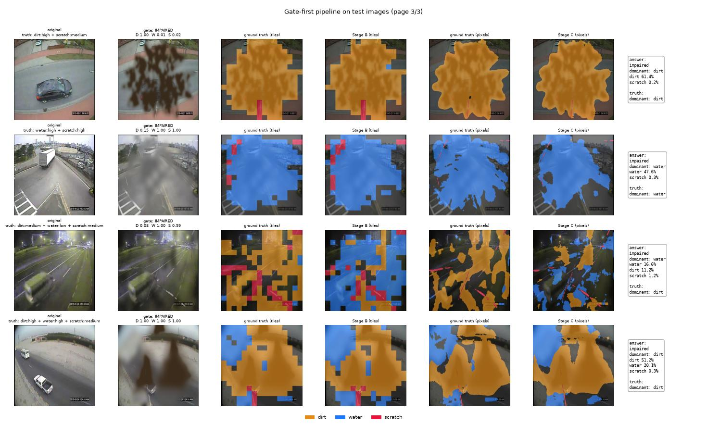
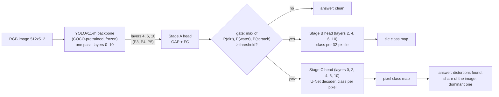
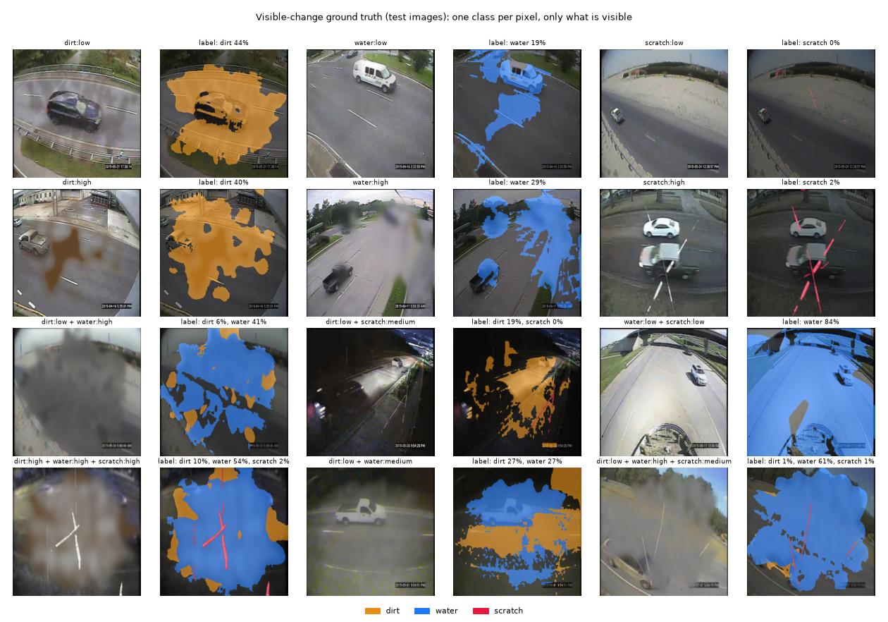
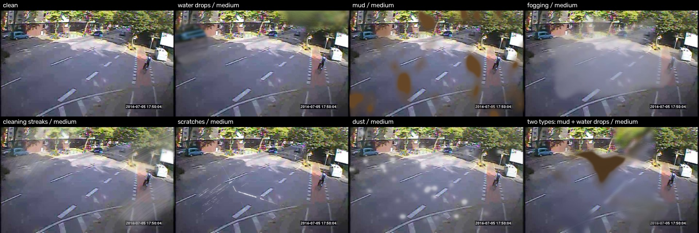

<a name="readme-top"></a>

# Camera-Lens Distortion Detection — Stages A, B and C

Master's thesis project (FAU Erlangen-Nürnberg): detecting **dirt, water and scratches** on the
protective glass in front of a camera, with a frozen YOLOv11 backbone and three small
"distortion heads" that answer increasingly detailed questions, **gate first**:

| Step | Question | Output |
|---|---|---|
| **A** — image level, **gate** | Is this image impaired, and by what? | P(dirt), P(water), P(scratch); clean images stop here |
| **B** — tile level | *Roughly where*, and which distortion? | one class per 32×32-px tile (16×16 grid), color-coded |
| **C** — pixel level | *Exactly where*, and which distortion? | one class per pixel, color-coded |
| **Answer** | What is the image's problem? | the distortions found, their share of the image, the dominant one |

Each tile and pixel gets the one distortion that is **visible** there (clean / dirt / water /
scratch), so overlapping distortions are labeled by what one actually sees.

The repository contains the complete development of all three stages (developed on the
branch `feature/stages-a-b-c`): data generation, models, training, evaluation, HPC job
scripts, reports and tests, plus the capture app and plan for the real data.
A standing project goal is to also catch **faint** (low-severity) distortions, so every result
is reported per severity level as well.

**Next step (in preparation).** The supervisor's capture protocol has **6 contamination
types**: mud, water drops, fogging, cleaning streaks, scratches and dust. Synthetic generators
for all six are built and approved ([`docs/synthetic_generators.md`](docs/synthetic_generators.md)),
the amounts of synthetic and real data are planned ([Planned dataset](#planned-dataset-target-amounts)),
and a capture app for the real two-camera data is ready
([`docs/data_collection/capture_plan.md`](docs/data_collection/capture_plan.md)). The models and
results below are still the 3-class ones; the dataset builder is updated to 6 classes next.

<p align="right">(<a href="#readme-top">back to top</a>)</p>

---

## Table of contents

1. [Results at a glance](#results-at-a-glance)
2. [How it works](#how-it-works)
3. [Data](#data) — [generators for the 6 types](#synthetic-generators-for-the-6-contamination-types-approved-session-29),
   [planned dataset](#planned-dataset-target-amounts), [real data capture](#real-data-capture)
4. [Models](#models)
5. [Getting started](#getting-started)
6. [Usage](#usage)
7. [Running on the FAU HPC (TinyGPU)](#running-on-the-fau-hpc-tinygpu)
8. [Repository structure](#repository-structure)
9. [Development history](#development-history)
10. [Key design decisions](#key-design-decisions)
11. [Known limitations and next steps](#known-limitations-and-next-steps)
12. [Documentation](#documentation)
13. [References and acknowledgments](#references-and-acknowledgments)

---

## Results at a glance

Held-out **test split** (1400 images from 100 source photos never seen in training; 1300 with a
visible distortion, 100 without). Every decision setting was tuned on the validation split.
Full results: [`docs/visible_pipeline_report.md`](docs/visible_pipeline_report.md).

| Level | dirt | water | scratch | faint (low-severity) recall dirt / water / scratch |
|---|---|---|---|---|
| **A** image — AP | 0.971 | 0.978 | 0.941 | 0.75 / 0.83 / 0.78 |
| **B** 32-px tile — F1 (IoU) | 0.859 (0.75) | 0.819 (0.69) | 0.782 (0.64) | 0.71 / 0.70 / 0.57 |
| **C** pixel — F1 (IoU) | 0.854 (0.75) | 0.797 (0.66) | 0.839 (0.72) | 0.66 / 0.60 / 0.68 |

**Image-level answer:** the dominant distortion is named correctly for **91.8%** of impaired
images (faint 80.9%, strong 98.3%); impaired vs. clean is right for 95.5% of all images, and 95%
of clean images are answered "clean". The **gate** (Stage A) keeps 98.5% of impaired images and
97.4% of faint ones.

In short: strong distortions are found and mapped reliably; faint ones remain the hard case,
faint water at pixel level most of all (recall 0.60); dirt and water are the pair most often
confused.


*Per test image: original / distorted with the gate's decision / tile ground truth / Stage B /
pixel ground truth / Stage C / answer. Orange = dirt, blue = water, red = scratch.*

The earlier multi-label models (three independent yes/no maps, a separate gate head, Sessions
15–26) are documented in the Stage A/B/C reports; their numbers measure a different task and
are not directly comparable.

<p align="right">(<a href="#readme-top">back to top</a>)</p>

---

## How it works



Backbone layers the heads read (map sizes for the 512×512 input):

| Layer | Module | Stride | Map size | Channels | Used by |
|---|---|---|---|---|---|
| 0 | `Conv` | 2 | 256×256 | 64 | Stage C |
| 2 | `C3k2` | 4 | 128×128 | 256 | Stage B, Stage C |
| 4 | `C3k2` (P3) | 8 | 64×64 | 512 | Stage A, Stage B, Stage C |
| 6 | `C3k2` (P4) | 16 | 32×32 | 512 | Stage A, Stage B, Stage C |
| 10 | `C2PSA` (P5, end of backbone) | 32 | 16×16 | 512 | all heads |

- The **backbone is never trained**; only the small heads are. This follows the "frozen
  backbone" option of [`architecture.md`](architecture.md) §3: the detection task the backbone
  serves can never be harmed by distortion training. It runs **once** per image; all heads read
  that one pass (`src/pipeline.py`).
- Each head reads the backbone at the depths (*strides*) that suit its task. A stride-*s* map
  has one position per *s*×*s* image patch: deep maps (stride 32, "P5") carry abstract scene
  content, shallow maps (stride 2–8) still carry the fine textures that faint distortions and
  thin scratches leave. The finer the output, the finer the maps that help (see the layer
  study in [Development history](#development-history)).
- **Stage A is the gate**: "impaired" means some distortion is present, which is what Stage A
  predicts. Only impaired images go on to Stages B and C. Its threshold keeps 98% of impaired
  validation images, so faint distortions are not lost at the first step.
- Stages B and C give **one class per location** (4-class softmax). A per-class offset tuned on
  validation is added before the most likely class is taken, to undo the lean toward rare
  classes that the class-weighted training gives.
- The **answer** counts a distortion as found when it covers at least its minimum share of the
  pixel map (dirt 10%, water 5%, scratch 0.07%, tuned on validation); the dominant one is the
  largest. An image that passes the gate but where nothing reaches its share is answered clean.

<p align="right">(<a href="#readme-top">back to top</a>)</p>

---

## Data

**Source photos.** 1000 frames from the public **MIO-TCD** (Miovision Traffic Camera Dataset,
localization part), sampled reproducibly (seed 0) by `scripts/sample_mio_tcd.py` from the
official tar archive, which must be downloaded separately.

**Synthetic distortions (current dataset and models).** No real contaminated images exist yet,
so distortions are synthesized. The current dataset was built with:

- **dirt** and **water** — from [`physical_lens_soiling`](https://github.com/JannLi/physical_lens_soiling),
  vendored in `third_party/` with the supervisor's permission;
- **scratch** — a custom procedural generator (broken streaks of varying width), since that
  repository has no scratch effect;
- **severity** — every effect is blended back toward the clean image at strength
  low 0.3 / medium 0.6 / high 1.0.

**Visible-change labels** (Session 27, `src/soiling/visible_labels.py`) — no manual annotation
is needed. For every distortion in an image, the image is re-rendered without it (the generator
is fully reproducible); how much each pixel differs is that distortion's visible contribution.
Each pixel is labeled with the distortion that changes it most, if by more than 10 gray levels,
otherwise clean; a visible scratch (the top layer) wins over what is under it. So a layer hidden
under another (dirt under a thick water film) is not labeled, and a faint distortion is labeled
wherever it is visible. Tiles take the class whose area exceeds its own cutoff (dirt 20%, water
25%, scratch 1.5% of the tile) by the largest factor; an image contains a class if at least 20
pixels carry it.



The earlier datasets used the generator's soft masks instead, with severity-independent ground
truth and every label audited against its image (`scripts/audit_dataset_labels.py`, Session 26).

**Datasets** (git-ignored, regenerated by the builder scripts):

| Dataset | Used by | Content |
|---|---|---|
| `data/processed/visible` | **all stages (current)** | 14000 images + class map per image (0 clean / 1 dirt / 2 water / 3 scratch, native resolution) + 16×16 tile classes + per-image class areas |
| `data/processed/stage_a` | earlier Stage A | 14000 images + image labels |
| `data/processed/stage_b` | earlier Stage B, C, gate | 14000 images + 16×16 tile labels + soft pixel masks |

Each source photo yields 14 variants: 1 clean, 9 single distortions (3 classes × 3
severities) and 4 combinations (dirt+water, dirt+scratch, water+scratch, all three). Splits are
made **by source photo** (no scene appears in two splits): **11200 / 1400 / 1400**
train / val / test. Model choices are made on the validation split; the test split is used
only for final numbers.

### Synthetic generators for the 6 contamination types (approved, Session 29)

For the next dataset, one generator per protocol type was built and approved by eye on sample
sheets of randomly chosen photos. Severity is now **how much contamination is on the pane**
(more droplets, larger stains, more wipe strokes, more sanding, more dust), not a fade, and a
lighter level is always part of the heavier one. Full description, parameters, which parts come
from the paper and which are ours, one sample per type and measured strength:
[`docs/synthetic_generators.md`](docs/synthetic_generators.md).


*One photo: clean, each type at medium, and a two-type example.*

| Type | Generator (`src/soiling/effects.py`) | Source | Light → medium → heavy |
|---|---|---|---|
| Water drops | `add_water_droplets` | Zhang et al. 2025, Fig. 1(g): vendored droplet code | 2–3 → 4–5 → 6–9 droplets |
| Mud | `add_mud_stains` | Fig. 1(b, c): vendored `add_mudByTxture` | stains shrink to 20% → 50% → 100% |
| Fogging | `add_fog` | vendored mist shapes (Fig. 1 f), own veil rendering | larger, denser, blurrier veil |
| Cleaning streaks | `add_cleaning_streaks` | own design | 1 → 3 → 6 wipe strokes |
| Scratches | `add_sanding_scratches` | own design (sandpaper, as in the protocol) | 1+1 → 2+2 → 4+4 sanding patches + long scratches |
| Dust | `add_dust` | Fig. 1(e): vendored dust texture | 1 → 3 → 6 layers of specks + a faint veil |

The dataset builder still makes the old 3-class layout; it is updated to 6 classes and the
planned counts before the next dataset is built (see [Known limitations](#known-limitations-and-next-steps)).

### Planned dataset (target amounts)

The next dataset covers all 6 contamination types of the capture protocol in equal amounts.
These are planned amounts; the dataset described above is the one that exists today. How the
real amounts are captured (button presses, combinations, file names) is in
[`docs/data_collection/capture_plan.md`](docs/data_collection/capture_plan.md).

- **3 severities** per type: light, medium, heavy.
- **Two-type images** are 10% of each dataset and hold exactly 2 types; 3 types together are not used.
- **3 pane distances** for the real data. The exact distances are still to be found in practice.
- **Fogging** is captured as images at different time intervals, not as video. The exact
  intervals are still to be found in practice.
- **Only the right pane** (camera 2C) is ever contaminated. Only right-camera images are network
  input; the left image (camera 97) is the clean reference for making the labels.

**Synthetic (images)**

| Category | Light | Medium | Heavy | Train | Validation | Test | Total |
|---|---:|---:|---:|---:|---:|---:|---:|
| Clean | – | – | – | 800 | 100 | 100 | **1,000** |
| Mud | 1,000 | 1,000 | 1,000 | 2,400 | 300 | 300 | **3,000** |
| Water drops | 1,000 | 1,000 | 1,000 | 2,400 | 300 | 300 | **3,000** |
| Fogging | 1,000 | 1,000 | 1,000 | 2,400 | 300 | 300 | **3,000** |
| Cleaning streaks | 1,000 | 1,000 | 1,000 | 2,400 | 300 | 300 | **3,000** |
| Scratches | 1,000 | 1,000 | 1,000 | 2,400 | 300 | 300 | **3,000** |
| Dust | 1,000 | 1,000 | 1,000 | 2,400 | 300 | 300 | **3,000** |
| Two types (15 combinations × 141) | – | – | – | 1,695 | 210 | 210 | **2,115** |
| **Total** | | | | **16,895** | **2,110** | **2,110** | **21,115** |

**Real (one pair = 1 right image + 1 left image)**

| Category | Light | Medium | Heavy | Pairs per distance | Total pairs | Total images |
|---|---:|---:|---:|---:|---:|---:|
| Clean | – | – | – | 36 | **108** | 216 |
| Mud | 30 | 30 | 30 | 30 | **90** | 180 |
| Water drops | 30 | 30 | 30 | 30 | **90** | 180 |
| Fogging | 30 | 30 | 30 | 30 | **90** | 180 |
| Cleaning streaks | 30 | 30 | 30 | 30 | **90** | 180 |
| Scratches | 30 | 30 | 30 | 30 | **90** | 180 |
| Dust | 30 | 30 | 30 | 30 | **90** | 180 |
| Two types (6 combinations × 12) | – | – | – | 24 | **72** | 144 |
| **Total** | | | | **240** | **720** | **1,440** |

### Real data capture

The real dataset is captured with two Allied Vision Alvium 1800 U-1240c cameras side by side,
a pane in front of each; only the right pane (camera 2C) is contaminated. The supervisor's
protocol is [`docs/data_collection/datacollection_surveilance_en.md`](docs/data_collection/datacollection_surveilance_en.md);
the decisions that change it, the amounts and the procedure are in
[`docs/data_collection/capture_plan.md`](docs/data_collection/capture_plan.md).

The **Stereo Capture** app (`src/capture/`, `scripts/capture_app.py`, packaged as a double-click
`.exe`) replaces Vimba X Viewer for capturing: live view of both cameras, the protocol form,
synchronized pairs saved as lossless PNG with the conditions in the file name
(`water_drops_medium_3cm_r1_0002_right_2C.png`), timed series for fogging, two-type captures,
and one log row per capture (`data/real_captures/capture_log.csv`).

<p align="right">(<a href="#readme-top">back to top</a>)</p>

---

## Models

| Component | Architecture | Loss | Trained parameters |
|---|---|---|---|
| Backbone | Ultralytics YOLOv11-m, COCO weights, frozen | — | 0 |
| Stage A head (+ gate) | global-average-pool each tap → concat → FC(64) → FC(3) | BCE with `pos_weight` | ~99k |
| Stage B head | 1×1 conv per tap (32 ch) → pool to 16×16 grid → 3×3 fuse → 4 classes per tile | softmax focal (γ 2), class weights ∝ 1/√frequency | ~95k |
| Stage C head | U-Net-style decoder over 5 taps, predicts at stride 2, upsampled to 512 px, 4 classes | class-weighted cross-entropy + Dice | ~452k |

Decision settings, all tuned on the validation split and stored in
`checkpoints/visible_pipeline.json`: Stage A's per-class thresholds (best F1), the gate
threshold (98% of impaired images kept), per-class offsets for the tile and pixel maps (best
mean F1) and the answer's minimum shares (best F1 per class). The separate impaired-gate head
(`ImpairedGateHead`) of the earlier design is still in the code but no longer used.

Implementation: `src/models/backbone.py` (frozen backbone, multi-layer taps),
`src/models/distortion_head.py` (all heads), `src/models/losses.py`.

<p align="right">(<a href="#readme-top">back to top</a>)</p>

---

## Getting started

**Requirements:** Python 3.11+, PyTorch, Ultralytics, OpenCV and the packages in
[`requirements.txt`](requirements.txt). Training was done on NVIDIA A100 / RTX 3080 / RTX 2080 Ti
GPUs; the code also runs on CPU (slowly) for smoke tests.

```bash
git clone https://github.com/pelemele1/Farhad_Vaseghi_MA.git
cd Farhad_Vaseghi_MA
git checkout feature/stages-a-b-c
python -m venv .venv && source .venv/bin/activate    # Windows: .venv\Scripts\activate
pip install -r requirements.txt
python -m pytest -q tests                             # 310 tests (the dataset-building ones take a while)
```

Download the COCO-pretrained YOLOv11-m weights (`yolo11m.pt`, from the Ultralytics releases) to
`weights/yolo11m.pt`. Then build the data:

```bash
python scripts/sample_mio_tcd.py --tar <path>/MIO-TCD-Localization.tar --out data/raw/mio_tcd --n 1000 --seed 0
python scripts/build_visible_dataset.py --source data/raw/mio_tcd/images --out data/processed/visible --workers 16
#   ^ The builders now call the six new generators but still make the old 3-class layout:
#     do not rebuild until they are updated to 6 classes. To reproduce the reported numbers,
#     check out commit 0438bff first.
# earlier multi-label datasets:
python scripts/build_stage_a_dataset.py --source data/raw/mio_tcd/images \
    --out data/processed/stage_a --variants 14 --include-combos --include-severity
python scripts/build_stage_b_dataset.py --source data/raw/mio_tcd/images \
    --out data/processed/stage_b --variants 14 --include-combos --include-severity \
    --dirt-threshold 0.20 --water-threshold 0.25 --scratch-threshold 0.015 --save-pixel-masks
python scripts/audit_dataset_labels.py   # checks every label against its image
```

<p align="right">(<a href="#readme-top">back to top</a>)</p>

---

## Usage

Every training script keeps the epoch with the best validation loss and writes it to `--out`.
Add `--smoke-test` to any training script for a 1-epoch CPU run on 8 images.

**Current pipeline** (visible-change labels, gate first)
```bash
python scripts/train_visible.py --stage a --data data/processed/visible --device cuda --out checkpoints/visible_a_w
python scripts/train_visible.py --stage b --data data/processed/visible --device cuda --out checkpoints/visible_b_w
python scripts/train_visible.py --stage c --data data/processed/visible --device cuda --out checkpoints/visible_c_v
python scripts/evaluate_visible.py --data data/processed/visible \
    --a checkpoints/visible_a_w/stage_a_head.pt --b checkpoints/visible_b_w/stage_b_head.pt \
    --c checkpoints/visible_c_v/stage_c_head.pt --device cuda \
    --config checkpoints/visible_pipeline.json --out-json results/visible_eval.json
python scripts/visualize_visible.py --data data/processed/visible --a ... --b ... --c ... \
    --config checkpoints/visible_pipeline.json --results results/visible_eval.json --out-dir docs/images
```
`evaluate_visible.py` tunes every decision setting on the validation split, writes them to
`--config`, and evaluates on test. In code:

```python
from src.pipeline import DistortionPipeline
pipe = DistortionPipeline("checkpoints/visible_a_w/stage_a_head.pt", "checkpoints/visible_b_w/stage_b_head.pt",
                          "checkpoints/visible_c_v/stage_c_head.pt", config="checkpoints/visible_pipeline.json")
result = pipe.predict(images)[0]      # images: (N, 3, 512, 512) RGB in [0, 1]
result["answer"]     # {"impaired": True, "dominant": "water", "shares": {"water": 0.41, "dirt": 0.12}}
result["pixel_map"]  # (512, 512): 0 clean / 1 dirt / 2 water / 3 scratch; result["tile_map"]: (16, 16)
```

The commands below train and evaluate the **earlier multi-label models** (Sessions 15–26).

**Stage A**
```bash
python scripts/train_stage_a.py --data data/processed/stage_a --taps 8,16,32 --epochs 20 \
    --img-size 640 --device cuda --out checkpoints/stage_a_multiscale_lf
python scripts/evaluate_stage_a.py --checkpoint checkpoints/stage_a_multiscale_lf/stage_a_head.pt \
    --data data/processed/stage_a --split test --tune-thresholds --by-severity
```

**Gate**
```bash
python scripts/train_impaired_gate.py --data data/processed/stage_b --arch multiscale \
    --img-size 512 --epochs 20 --device cuda --out checkpoints/impaired_gate_multiscale_lf
python scripts/evaluate_impaired_gate.py --checkpoint checkpoints/impaired_gate_multiscale_lf/impaired_gate_head.pt \
    --data data/processed/stage_b --split test --tune-thresholds --recall-target 0.95
```

**Stage B**
```bash
python scripts/train_stage_b.py --data data/processed/stage_b --arch multiscale --hflip \
    --hidden-dim 32 --fuse-kernel 3 --epochs 40 --loss focal --focal-alpha 0.75 --focal-gamma 2.0 \
    --device cuda --out checkpoints/stage_b_h32_lf
python scripts/evaluate_stage_b.py --checkpoint checkpoints/stage_b_h32_lf/stage_b_head.pt \
    --data data/processed/stage_b --split test --tune-thresholds --by-severity \
    --gate-checkpoint checkpoints/impaired_gate_multiscale_lf/impaired_gate_head.pt --gate-threshold 0.172
```

**Stage C**
```bash
python scripts/train_stage_c.py --data data/processed/stage_b --arch unet --taps 2,4,8,16,32 \
    --epochs 25 --batch-size 16 --img-size 512 --device cuda --out checkpoints/stage_c_unet_t2_lf
python scripts/evaluate_stage_c.py --checkpoint checkpoints/stage_c_unet_t2_lf/stage_c_head.pt \
    --data data/processed/stage_b --split test --tune-thresholds --by-severity \
    --gate-checkpoint checkpoints/impaired_gate_multiscale_lf/impaired_gate_head.pt --gate-threshold 0.172
```

**Synthetic generators** — sample figures and measured strength of the six generators:
```bash
python scripts/render_generator_samples.py --source data/raw/mio_tcd/images \
    --out-dir docs/images/generators --stats-json results/generator_stats.json
```
In code: `render_effect(name, image, seed, severity)` from `src/soiling/effects.py`, with
`name` in `water`, `dirt` (mud), `fogging`, `cleaning_streaks`, `scratch`, `dust` and
`severity` in `low`, `medium`, `high`; it returns the image and the effect's mask.

**Capture app** (real data; close Vimba X Viewer first)
```bash
python scripts/capture_app.py                         # or the packaged StereoCapture.exe
python scripts/capture_app.py --check result.txt      # grab one pair without a window
```
Packaging: `pyinstaller --windowed --onedir --name StereoCapture --collect-all vmbpy --paths . scripts/capture_app.py`
(VmbPy is installed from the wheel shipped with Vimba X).

**Report figures** — `scripts/visualize_stage_{a,b,c}_results.py` and
`scripts/visualize_stage_a_class_examples.py`; `scripts/hpc/regenerate_report_figures.sh`
rebuilds every figure used in the reports in one go.

Useful options: `--taps` (backbone strides a head reads), `--class-weights` (per-class loss
weights), `--low-severity-weight` (oversample faint images), and for Stage B `--hflip`,
`--weight-decay`, `--dropout`, `--hidden-dim`, `--fuse-kernel`.

<p align="right">(<a href="#readme-top">back to top</a>)</p>

---

## Running on the FAU HPC (TinyGPU)

All final models were trained on NHR@FAU's TinyGPU cluster. Setup and job submission are
described in [`docs/hpc_stage_a.md`](docs/hpc_stage_a.md); job scripts live in `scripts/hpc/`:

- `setup_env.sh` — one-time conda environment;
- `run_python.slurm` / `run_shell.slurm` — run any command (or "train && evaluate") on a GPU node;
- `layer_study.sh`, `stage_b_regularization.sh`, `stage_b_small_head.sh` — the experiment
  sweeps behind the reports;
- `regenerate_report_figures.sh` — all report figures;
- `retrain_after_label_fix.sh`, `evaluate_after_label_fix.sh` — the Session 26 retraining;
- `train_visible.sh`, `evaluate_visible.sh` — the current pipeline (Session 27).

Practical notes: a100/v100 jobs need a typed GPU request (`--gres=gpu:a100:1`); V100 nodes need
the second environment `stage_a_v100` (PyTorch built for CUDA 12.6, which still supports them),
selected with `--export=NONE,CONDA_ENV=stage_a_v100`; Slurm scripts must have LF line
endings and use `python3 -u` so logs appear immediately. The raw stdout of every job behind the
reported numbers is kept at the repository root (`*_<jobid>.out`) and in `study_logs/`.

<p align="right">(<a href="#readme-top">back to top</a>)</p>

---

## Repository structure

```text
.
├── architecture.md          # design concept: shared backbone + distortion head, Stages A/B/C
├── overview.md, setup.md    # thesis overview; two-camera rig (Part 1)
├── src/
│   ├── pipeline.py          # gate-first inference: one backbone pass, A -> B/C -> answer
│   ├── capture/             # Stereo Capture app: two-camera rig, protocol bookkeeping, window
│   ├── data/                # MIO-TCD sampling, datasets (visible_dataset.py: all stages)
│   ├── soiling/             # distortion effects (6 approved generators), dataset builders, visible-change labels
│   ├── models/              # frozen backbone, all heads, losses
│   └── eval/                # metrics (class_maps.py: one-class-per-location maps), thresholds, gate
├── scripts/                 # build_*, train_*, evaluate_*, visualize_*, capture_app.py, render_generator_samples.py
│   └── hpc/                 # TinyGPU Slurm/shell scripts
├── tests/                   # pytest suite (310 tests)
├── docs/
│   ├── visible_pipeline_report.md   # current pipeline (Session 27)
│   ├── synthetic_generators.md      # the six approved generators (Session 29)
│   ├── data_collection/     # supervisor's capture protocol + our capture plan and app usage
│   ├── stage_a_final_report.md, stage_b_final_report.md, stage_c_final_report.md
│   ├── development_log.md   # full session-by-session history
│   ├── data_collection_pipeline.md, hpc_stage_a.md
│   ├── diagrams/            # architecture diagram (draw.io)
│   └── images/              # all report figures (generators/: one sample per generator)
├── thesis/                  # thesis LaTeX template and writing guidelines (from the supervisor)
├── third_party/physical_lens_soiling/   # vendored dirt/water generator
├── notebooks/               # Colab notebook used for one Stage B run
├── results/                 # visible_eval.json (current report), generator_stats.json
├── study_logs/, *_<jobid>.out           # raw HPC job logs behind the reported numbers
├── raw/, wiki/              # personal reading knowledge base (see CLAUDE.md), not code
└── data/, checkpoints/, weights/        # git-ignored: datasets, trained heads, YOLO weights
```

<p align="right">(<a href="#readme-top">back to top</a>)</p>

---

## Development history

The full record — every decision, dead end and intermediate number — is in
[`docs/development_log.md`](docs/development_log.md). In summary:

| When | Sessions | What was done |
|---|---|---|
| 2026-08-23 | 1–5 | Scope set to Stage A on MIO-TCD. 1000-image pilot subset. `physical_lens_soiling` vendored for dirt/water; custom scratch generator built and tuned against a real scratched-lens photo. |
| 2026-08-24 | 6–14 | Dataset builder; frozen YOLOv11-m + Stage A head; training script; TinyGPU setup and first real runs (three hardware-specific bugs fixed); evaluation script; first Stage A report; field protocol for the real two-camera capture. |
| 2026-08-31 – 09-04 | 15–18 | **Stage B** tile classification. Scratch tiles are rare (~1–2%), so plain BCE over-predicted scratch everywhere; **focal loss** (α 0.75) fixed it. Remediation experiments; Stage A qualitative examples. |
| 2026-09-17 – 09-25 | 19–20 | Supervisor feedback: architecture diagram, ROC/PR curves, per-class thresholds, a localized sum-of-squares loss (compared, not adopted), **multi-distortion combos**, the **impaired gate** as a real inference-time filter, tile-threshold recalibration, and **balanced low/medium/high severities**. |
| 2026-09-26 | 21 | **Stage C** pixel segmentation, v1 (decoder on P5 only — scratch AP 0.17). |
| 2026-09-26 | 22 | Full audit. Main bug: ground truth had been scaled by severity, labeling most of a faint patch as clean — fixed to **severity-independent** labels. Multi-scale Stage B head and **U-Net** Stage C decoder; gate calibration fixed (resolution mismatch; threshold by recall target). |
| 2026-09-26/27 | 23 | **Layer study** for every stage, plus a new stride-2 tap: A best at strides 8–32, B at 4–32, C at 2–32, gate at 4–32. Extra loss weight on scratch tested and rejected (it hurt faint dirt/water). |
| 2026-09-27 | 24–25 | **Stage B overfitting**: train/val gap from too few distinct scenes. Weight decay and dropout only delayed it; horizontal flips plus a **smaller 32-channel head** keep validation loss improving to epoch 38, at −0.005 AP, and cut clean-image false alarms (water 42% → 15%). |
| 2026-09/10 | — | Report figures cleaned up (legends, titles, axis labels); branch renamed from `feature/stage-a-mio-tcd` to `feature/stages-a-b-c`. |
| 2026-10-08/09 | 26 | **Label audit of all 28,000 images.** A report figure called a dirt + water image "dirt"; checking every label then found three generator defects: thin-water masks with a 0.2 floor over the whole image (1966 masks), 9 rendered distortions with an all-zero mask, and 44 practically invisible scratches per dataset. Fixed in the generator and in place; all four models retrained (on V100s, via a second CUDA-12.6 environment). Effect: Stage B water AP was overstated by ~0.02 on the old labels; everything else moved by ≤ 0.013. |
| 2026-10-09 | 27 | **Gate-first pipeline with visible-change labels.** The gate now comes first (Stage A itself), Stages B and C give one class per location as color-coded maps, and an image-level answer names the dominant distortion. Labels mark only what is visible, measured by re-rendering each image without each distortion (made possible by fixing the generator's hidden reseeding). New dataset, all three heads retrained; dominant distortion correct for 91.8% of impaired test images. |
| 2026-11-07 – 11-10 | 28 | **Stereo Capture app** for the real two-camera data, following the supervisor's protocol: synchronized pairs, conditions in the file names, per-capture log, timed fogging series, two-type captures, packaged as a double-click app. Real-camera problems fixed (camera mapping by serial, USB 2 check, locked parameters, hang on close). Decisions: panes on both lenses, only the right pane contaminated. |
| 2026-11-09 – 11-12 | 29 | **Planned dataset and six approved generators.** Amounts for 6 types × 3 severities (21,115 synthetic images, 720 real pairs, 10% with two types). One generator per protocol type, each approved by the user on sample sheets; severity as the amount of contamination. The dataset builder is not yet updated, so no data was regenerated. |

Effect of the main improvements on faint-distortion AP (test split, dirt / water / scratch):

| Stage | Before | After |
|---|---|---|
| A | 0.702 / 0.773 / 0.665 (P5 only) | 0.867 / 0.888 / 0.737 (strides 8–32) |
| B | 0.27 / 0.24 / 0.20 (P5-only head) | 0.804 / 0.735 / 0.663 (multi-scale, flips, 32 ch) |
| C | scratch AP 0.17 overall (P5-only decoder) | 0.731 / 0.659 / 0.544 (U-Net, strides 2–32) |

("After" is measured on the audited labels, which are stricter for water than the ones the
"before" numbers used.)

<p align="right">(<a href="#readme-top">back to top</a>)</p>

---

## Key design decisions

- **Frozen backbone** — no risk of degrading the primary detection task; only 0.1–0.45M
  parameters per head are trained.
- **Multi-layer taps instead of P5 only** — deviates from the literal `architecture.md` Stage A
  design (kept as `--taps 32` for reference) because the finer maps roughly triple faint-distortion
  AP in Stage B, make thin scratches segmentable in Stage C, and add +0.13 faint AP in Stage A.
- **Gate first, and the gate is Stage A** — a separate gate head answered the same question
  less well and erased faint scratches; the gate threshold keeps 98% of impaired images.
- **One visible class per location** — overlapping distortions are labeled by what is visible,
  measured from the rendered images, not from the generator's masks.
- **Decision settings tuned on validation** — map offsets undo the class-weight bias; minimum
  shares keep stray specks out of the answer.
- **Severity-independent ground truth** (earlier datasets) — required for the faint-distortion
  goal; replaced by visibility in Session 27, which still labels faint distortions where visible.
- **Every label verified against its image** — an invisible effect is re-drawn rather than
  labeled; the dataset audit is a script, so it can be rerun after any generator change.
- **Focal loss for Stage B** — handles the extreme tile-level imbalance of scratches.
- **Per-class thresholds** tuned on validation; **gate threshold by recall** (≥ 95%).
- **Selection on validation, reporting on test** — the test split never influenced a choice.
- **Stage B: flips + 32-channel head** — the best trade-off between accuracy and overfitting;
  other augmentations (color, crops, vertical flips) were ruled out because they would change
  what a faint distortion looks like or break the tile grid.

<p align="right">(<a href="#readme-top">back to top</a>)</p>

---

## Known limitations and next steps

- **Synthetic distortions only.** Nothing has been measured on real soiled-lens photos. The
  capture app and plan are ready; the real two-camera capture (720 pairs) is the next step, with
  Stage C pseudo-masks from difference images as `architecture.md` §5 describes.
- **3 classes so far.** The current models know dirt, water and scratch. The six new
  generators are approved, but the dataset builder still makes the old 3-class layout with up
  to three types per image; it needs the 6 classes, two-type images only (10%) and the planned
  counts before the new dataset is built and all heads are retrained.
- **Capture app** — tested with a simulated camera (24 tests); its current version (new file
  names, timed fogging, two types) has not yet run on the real cameras. The 3 pane distances
  and the fogging interval are still to be measured.
- **Small pilot dataset** — 1000 source scenes. Stage B still shows a small train/val gap that
  only more distinct scenes (e.g. more MIO-TCD images) would close without losing accuracy.
- **Faint distortions** remain the hardest case at every level; faint water at pixel level is
  the weakest (recall 0.60), and dirt and water are the pair most often confused.
- **The gate passes 70% of clean images** at the setting that keeps 97% of faint distortions;
  the answer then relies on minimum shares, so a real dirt patch smaller than 10% of the image
  is drawn in the maps but not named in the answer.
- **Stages B and C overfit mildly** (validation loss levels off after ~12–20 epochs).
- **Backbone never fine-tuned** — joint training (`architecture.md` §3, option 2) is untested.

<p align="right">(<a href="#readme-top">back to top</a>)</p>

---

## Documentation

| Document | Content |
|---|---|
| [`docs/visible_pipeline_report.md`](docs/visible_pipeline_report.md) | **Current pipeline**: gate first, visible-change labels, class maps, image-level answer — method, results per severity, figures |
| [`docs/stage_a_final_report.md`](docs/stage_a_final_report.md) | Stage A and the gate: method, layer study, results per severity, figures |
| [`docs/stage_b_final_report.md`](docs/stage_b_final_report.md) | Stage B: tile labels, layer study, overfitting study, results, figures |
| [`docs/stage_c_final_report.md`](docs/stage_c_final_report.md) | Stage C: U-Net decoder, layer study, pooled-cell evaluation, results, figures |
| [`docs/synthetic_generators.md`](docs/synthetic_generators.md) | The six approved contamination generators: method, source (paper or own), severity parameters, one sample each, measured strength |
| [`docs/data_collection/datacollection_surveilance_en.md`](docs/data_collection/datacollection_surveilance_en.md) | The supervisor's capture protocol (unchanged) |
| [`docs/data_collection/capture_plan.md`](docs/data_collection/capture_plan.md) | Decisions that change the protocol, amounts to capture per category, capture app usage, file names |
| [`docs/development_log.md`](docs/development_log.md) | Complete chronological development history (Sessions 1–29) |
| [`architecture.md`](architecture.md) | Design concept the stages follow |
| [`docs/data_collection_pipeline.md`](docs/data_collection_pipeline.md) | Earlier field protocol for the two-camera rig (Sessions 6–14; partly replaced by the two documents above) |
| [`docs/hpc_stage_a.md`](docs/hpc_stage_a.md) | How to run on NHR@FAU TinyGPU |

Each report ends with the exact commands that reproduce its numbers and figures.

<p align="right">(<a href="#readme-top">back to top</a>)</p>

---

## References and acknowledgments

- **MIO-TCD** — Luo et al., "MIO-TCD: A New Benchmark Dataset for Vehicle Classification and
  Localization", IEEE TIP 2018.
- **physical_lens_soiling** — https://github.com/JannLi/physical_lens_soiling (dirt and water
  effects, vendored with permission), the code of Zhang et al., "Procedural generation of lens
  soiling data via physics-based simulation", The Visual Computer 41, 2025 — the source of the
  water-drop, mud, fogging and dust generators.
- **SIDL** — Choi, Park and Kim, "SIDL: A Real-World Dataset for Restoring Smartphone Images
  with Dirty Lenses", AAAI 2025 (fingerprint smears blur and defocus the image; basis for the
  cleaning-streak rendering).
- **CLP** — Park et al., "CLP: A Real-World Dataset of Contaminated Lens Protectors for Robust
  Semantic Segmentation", CVPR (real water, mud and condensation at 0, 1, 3 and 5 cm
  lens-to-protector distance; orientation for our pane distances).
- **YOLOv11** — Ultralytics, https://github.com/ultralytics/ultralytics.
- **OmniDet** — Kumar et al., RA-L 2021 (shared encoder, soiling decoder, frozen-encoder training).
- **SoilingNet** — Uricár et al., 2019 (tile-level soiling classification, the basis of Stage B).
- **Focal loss** — Lin et al., "Focal Loss for Dense Object Detection", ICCV 2017.
- **U-Net** — Ronneberger et al., MICCAI 2015.

Computing resources: NHR@FAU (TinyGPU cluster), Friedrich-Alexander-Universität
Erlangen-Nürnberg.

**Author:** Farhad Vaseghi — Master's thesis, FAU Erlangen-Nürnberg.

<p align="right">(<a href="#readme-top">back to top</a>)</p>
