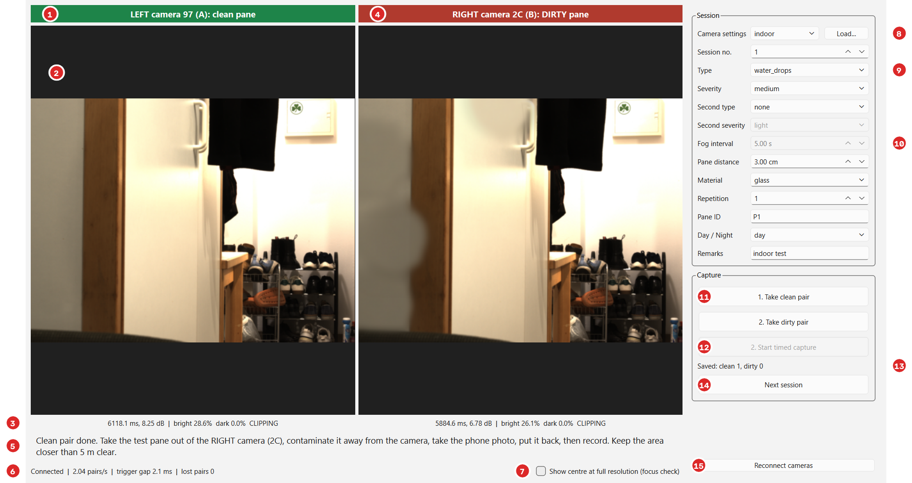
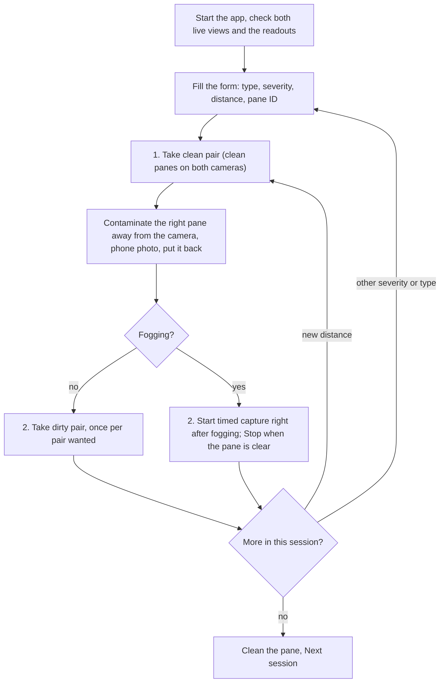

# Stereo Capture — the capture app

**Status:** ready. Tested with a simulated camera pair (24 tests). The real-camera runs (complete
4024 × 3036 frames, no lost pairs, trigger gap 1–7 ms, about 0.4 pairs/s with the long indoor
exposures) were done before the file-naming, fogging and two-type changes; the current version
still needs one real-camera test.

Stereo Capture replaces Vimba X Viewer for capturing the real dataset: one window that shows both
cameras, holds the protocol form, takes synchronized pairs with one click, names every file by
its conditions and writes the capture log. What to capture is in
[`data_collection/capture_plan.md`](data_collection/capture_plan.md); the protocol it follows is
[`data_collection/datacollection_surveilance_en.md`](data_collection/datacollection_surveilance_en.md).

---

## 1. The window


*The window during a session, just after the clean pair: left camera with its clean pane, right
camera with the test pane (here water drops, simulated). Rendered with a simulated camera pair by
`scripts/render_capture_app_figure.py`; the view is a real indoor test capture.*

| # | Part | What it shows or does |
|---|---|---|
| 1 | Left camera title | Camera 97 (A), **green**: always the clean pane |
| 2 | Live view | The newest synchronized pair, scaled to fit; the same frames that a capture saves |
| 3 | Readout | Exposure and gain actually set on the camera; share of blown-out (**bright**) and fully black (**dark**) pixels; **CLIPPING** when more than 1% is blown out or more than 5% is black |
| 4 | Right camera title | Camera 2C (B), **red**: always the test (dirty) pane |
| 5 | Instruction line | The next step of the protocol, in words (see §3) |
| 6 | Link status | Connected or not, pairs per second, trigger gap between the two cameras, incomplete pairs skipped |
| 7 | Focus check | Shows the centre of each image at full resolution instead of the whole frame, for focusing the lenses |
| 8 | Camera settings | Profile of saved settings (e.g. `indoor`), loaded into both cameras; **Load...** picks any two settings files |
| 9 | Session form | Session number, type, severity, second type and severity, pane distance, material, repetition, pane ID, day / night, remarks — the protocol's log fields |
| 10 | Fog interval | Seconds between pairs of a timed fogging series (active only when the type is fogging) |
| 11 | **1. Take clean pair** | One pair with clean panes in front of both cameras |
| 12 | **2. Take dirty pair** / **2. Start timed capture** | One pair with the contaminated test pane; for fogging, a series at the fog interval until **Stop timed capture** |
| 13 | Saved count | Clean and dirty pairs saved in this session so far |
| 14 | **Next session** | Writes any pending log entry and moves to the next free session number |
| 15 | **Reconnect cameras** | Opens the cameras again, e.g. after a cable was re-plugged |

---

## 2. Features

**Cameras**
- Opens both Allied Vision Alvium cameras through VmbPy (Vimba X) and loads each camera's saved
  settings before the first frame.
- Matches each settings file to its camera by the **serial number inside the file**, never by the
  file name, so a camera can never get the other camera's values.
- **Synchronized pairs:** both cameras run in software-trigger mode; the app fires both, one
  frame each, and waits for both. Preview and saved images are the same pair. A capture starts
  only with the next triggered pair, so a frame exposed before the button press is never saved.
- **Checks on start:** both cameras present and free (Vimba X Viewer closed), USB 3 speed
  (at least 200 MB/s; at USB 2 speed loading the settings fails), RGB8 pixel format. Each failure
  is reported in plain words, e.g. "Camera 97 is connected at USB 2 speed".
- Unlocks the transport-layer parameters that Viewer files lock (`TLParamsLocked`), so the
  trigger mode can be set; switches the trigger off again and always releases both cameras on
  close.
- Stops with a message after 3 incomplete pairs in a row, instead of saving broken pairs.

**Capturing**
- One press = one pair. Each press adds a new pair; nothing is ever overwritten.
- **Timed series for fogging:** the first pair at once, then one per fog interval, named by the
  real seconds since the series began (`fogging_t015s_...`).
- **Two types on one pane:** a second type and severity in the form; the file name carries both
  (`water_drops_light_and_mud_heavy_...`). Fogging can only be the first type; the second type
  must differ from the first.
- **Lossless PNG** (about 15 MB per image), saved on background threads; a slow disk slows the
  capture down instead of dropping pairs.
- The form is locked while a capture runs.

**Guidance** — the buttons follow the protocol order: nothing before the pane ID is entered,
no dirty pair before a clean pair. The instruction line says what to do next; when the pane
distance changes, it reminds you to take a clean pair at the new distance first.

**Bookkeeping**
- Every capture is one row in `capture_log.csv` with the protocol's fields and the camera values
  actually used (exposure, gain and white balance of both cameras).
- Every folder has a `pairs.csv`: per pair the time, the trigger gap, the frame IDs and the
  cameras' own timestamps.
- If the log is open in Excel, the entry is kept and written with the next capture; the images
  are always saved.
- Choosing an earlier session number fills the form with that session's last values.

---

## 3. A session step by step



The instruction line (5) walks through the same steps:

| Situation | Instruction |
|---|---|
| No pane ID yet | Enter the pane ID; which camera the test pane goes in front of |
| No clean pair yet | Put clean panes in front of both cameras, then take the clean pair |
| Pane distance changed | No clean pair at this distance yet: take one first |
| Clean pair done | Take the test pane out, contaminate it away from the camera, take the phone photo, put it back, then record |
| Fogging selected | Fog the test pane, then press Start timed capture straight away |
| During a timed series | Taking one pair every N s; press Stop when the pane is clear |
| Second type equals the first | The second type must be different |
| After a capture | For another severity or distance change the form and capture again; Next session when done |

---

## 4. Files

```text
data/real_captures/
├── capture_log.csv                                        one row per capture
└── session_0003/
    ├── clean/
    │   ├── clean_3cm_r1_0001_left_97.png
    │   ├── clean_3cm_r1_0001_right_2C.png
    │   └── pairs.csv
    └── dirty/
        ├── water_drops_light_3cm_r1_0001_left_97.png      type_severity_distance_repetition_pair_camera
        ├── water_drops_light_3cm_r1_0001_right_2C.png
        ├── water_drops_light_and_mud_heavy_3cm_r1_0002_right_2C.png   two types
        ├── fogging_t015s_3cm_r1_0003_right_2C.png         seconds since the fog series began
        └── pairs.csv
```

Images with the same pair number were taken together. All dirty images of a session share one
folder; the conditions are in the names, so one session can hold several types, severities and
distances.

**Log columns:** date and time, session, dirty camera (letter and name), material, pane distance,
type, severity, repetition, pane ID, day / night, remarks, second type and severity, fog interval,
stage (clean / dirty), first pair number, pairs, left and right file name, settings profile, and
exposure, gain and red / blue balance of each camera.

---

## 5. Running and packaging

- **Double-click:** `D:\MasterThesis_FAU\StereoCapture\StereoCapture.exe` (desktop shortcut
  "Stereo Capture"). Close Vimba X Viewer first: only one program can control a camera.
- **From the code:** `python scripts/capture_app.py` (`--root` for the data folder, default
  `data/real_captures`; `--settings-dir` for the settings files, default
  `D:/MasterThesis_FAU/CameraSettings`).
- **Check without a window:** `python scripts/capture_app.py --check result.txt` (or the `.exe`
  with the same option) opens both cameras, grabs one pair and writes `OK ...` or `FAILED: ...`.
- **Settings files** are saved per camera in Vimba X Viewer as
  `<profile>_leftCamera_97.xml` and `<profile>_rightCamera_2C.xml`.
- **Packaging** (in a clean virtual environment with PySide6, OpenCV, NumPy, PyInstaller and the
  VmbPy wheel from the Vimba X installation):

```bash
pyinstaller --noconfirm --windowed --onedir --name StereoCapture --collect-all vmbpy \
    --exclude-module tkinter --paths . scripts/capture_app.py
```

---

## 6. Code and tests

| File | Role |
|---|---|
| `src/capture/rig.py` | The two cameras: open, load settings, checks, software trigger, synchronized pairs, release |
| `src/capture/session.py` | The protocol's bookkeeping: camera mapping, file names, PNG saving, `pairs.csv`, the capture log |
| `src/capture/app.py` | The window, the capture thread, the form and the instruction line |
| `scripts/capture_app.py` | Start the app, or `--check` |
| `scripts/render_capture_app_figure.py` | The screenshot above |
| `tests/test_capture_app.py` | 24 tests with a simulated camera pair: button order, file names with severities, distances, two types and fog times, numbering within a folder, the timed series, settings matched by serial, the log surviving a locked file, cameras released on close |

## 7. Limitations

- Software trigger only; the two exposures overlap but do not start at the same instant, so a
  fast-moving object can differ slightly between the two images. A hardware trigger is not
  implemented.
- The current version (file names, timed fogging, two types) has not yet run on the real cameras.
- The fogging time that counts as light, medium and heavy is decided once the clearing time has
  been measured.
