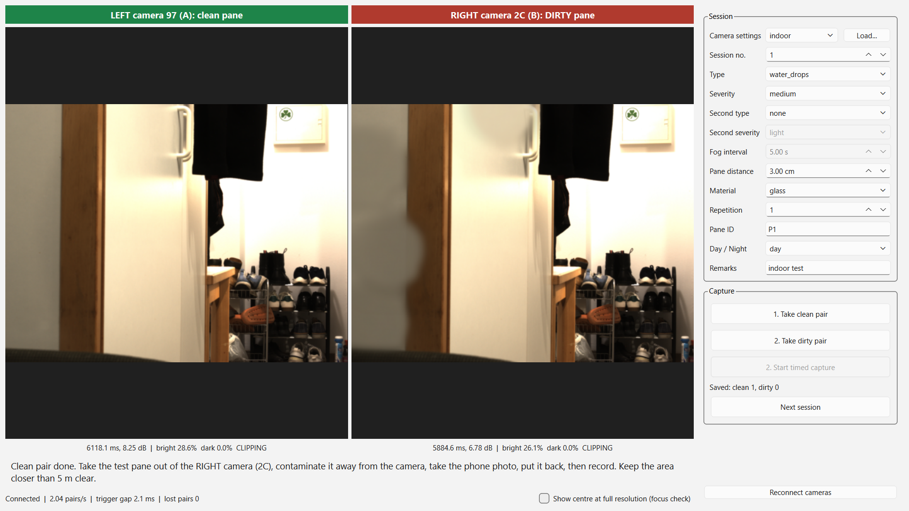

# Real data capture plan

**Status:** planned, not yet captured. The capture app is built and tested with a simulated
camera; its last real-camera test was before the file-naming, fogging and two-type changes
described below.

This plan applies the supervisor's protocol
([`datacollection_surveilance_en.md`](datacollection_surveilance_en.md), kept unchanged) to our
rig, and records every decision taken since that changes it. Where the two differ, this plan
holds.

---

## 1. Decisions that change the protocol

| Topic | Protocol says | Decision | By |
|---|---|---|---|
| Panes | Clean pane in front of one camera, contaminated pane in front of the other | A pane is in front of **both** lenses in every capture; only the test pane is contaminated | user and supervisor |
| Dirty camera | Alternate: odd session → camera A, even session → camera B | **Always the right pane** (camera 2C, letter B). The network is trained and tested on right-camera images only; the left image (camera 97) is the clean reference for the labels | user |
| Camera settings | Identical exposure, gain and white balance on both cameras | Each camera keeps its own exposure and gain, because those values give the two closest images (profile `indoor`) | user |
| Fogging | 30 s of video until the pane is clear | **Images at fixed time intervals** while the fog clears; the interval is still to be tested | supervisor |
| Pane distance | "Vary the distance" | **Exactly 3 distances**, values still to be tested | supervisor |
| Mixed contamination | not covered | **Two types on one pane**, 10% of the dataset, never three | supervisor and user |
| Pairs per step | 10 synchronized pairs per session | One pair per button press; 5 presses per contamination application (see §2) | user; open point for the supervisor |
| Synchronization | Hardware trigger or common timestamp | Software trigger on both cameras, fired back to back (≈1–7 ms apart, measured) | implementation |

The CLP dataset (Park et al., raw/papers) used lens-to-protector distances of 0, 1, 3 and 5 cm,
which is a useful orientation when choosing our 3 distances.

---

## 2. How much to capture

All 6 contamination types in equal amounts, 3 severities each, at each of the 3 distances.

| Category | Light | Medium | Heavy | Pairs per distance | Total pairs | Total images |
|---|---:|---:|---:|---:|---:|---:|
| Clean | – | – | – | 36 | **108** | 216 |
| Mud | 30 | 30 | 30 | 30 | **90** | 180 |
| Water drops | 30 | 30 | 30 | 30 | **90** | 180 |
| Fogging | 30 | 30 | 30 | 30 | **90** | 180 |
| Cleaning streaks | 30 | 30 | 30 | 30 | **90** | 180 |
| Scratches | 30 | 30 | 30 | 30 | **90** | 180 |
| Dust | 30 | 30 | 30 | 30 | **90** | 180 |
| Two types (6 combinations × 12) | – | – | – | 24 | **72** | 144 |
| **Total** | | | | **240** | **720** | **1,440** |

One **pair** is one press of a capture button: one right image and one left image taken at the
same moment. About 15 MB per image, so about 22 GB in total.

**Where the numbers come from**

- **One type:** 6 types × 3 severities × 3 distances = 54 conditions. For each, contaminate the
  pane twice (2 independent applications) and press 5 times each time: 10 pairs per condition,
  30 per type and severity, 90 per type.
- **Clean:** one clean pair before each of the 108 applications (36 per distance).
- **Two types:** 6 combinations × 3 distances × 4 presses = 72 pairs, 10% of the 720. Within a
  combination, each type gets 4 pairs at each severity.

**Two-type combinations** — a ring, so every type appears in exactly 2 combinations and all 6
types are equally represented (24 pairs each):

| Combination | Pairs |
|---|---:|
| water drops + mud | 12 |
| mud + fogging | 12 |
| fogging + cleaning streaks | 12 |
| cleaning streaks + scratches | 12 |
| scratches + dust | 12 |
| dust + water drops | 12 |

For the fogging combinations, apply the other contamination first, then fog the pane.

**Button presses:** 108 clean + 540 one-type + 72 two-type = **720 presses**. For one type at
one severity and distance: clean pair (1) → contaminate → dirty pair (5) → clean the pane →
clean pair (1) → contaminate again → dirty pair (5). Two-type captures share the clean pair of a
session at the same distance.

**Practical notes**
- Scratches cannot be undone: use 2 panes per material and sand each one from light to heavy.
- Fogging clears quickly: several fogging events per distance will be needed for 10 pairs per
  severity. Choose the time interval so every severity gets the same number of pairs.
- Spread the sessions over lighting and weather conditions instead of multiplying the totals.
- **Split the real data by contamination application, never by image** — the 5 pairs of one
  application are nearly identical.
- 720 pairs are enough to test on real images and possibly to fine-tune, not to train from scratch.

---

## 3. The rig

| Position | Name on camera | Serial | Protocol letter | Pane |
|---|---|---|---|---|
| left | 97 | 05NRR | A | always clean |
| right | 2C | 05HYK | B | **test pane** |

Cameras: 2× Allied Vision Alvium 1800 U-1240c (4024 × 3036, USB 3), controlled with Vimba X.
Camera settings are saved from Vimba X Viewer as one XML file per camera in
`D:/MasterThesis_FAU/CameraSettings` (`<profile>_leftCamera_97.xml`,
`<profile>_rightCamera_2C.xml`); the app matches each file to its camera by the serial number
inside the file, not by its name.

---

## 4. Capture app (Stereo Capture)

Captured with the Stereo Capture app — window, features, step-by-step use, files and
packaging are described in [`../capture_app.md`](../capture_app.md).



**Steps**
1. Enter the pane ID and the conditions.
2. **1. Take clean pair** with clean panes in front of both cameras.
3. Contaminate the right pane away from the camera, put it back.
4. **2. Take dirty pair** — each press adds one pair; nothing is ever overwritten.
   For fogging: **2. Start timed capture** right after fogging; it takes the first pair at once
   and then one per interval, until **Stop timed capture**.
5. For another severity or distance, change the form and capture again; at a new distance the
   app reminds you to take a clean pair first.
6. **Next session** when the pane is cleaned for a new session.

**Files** (all dirty images of a session in one folder; the name carries the conditions):

```text
data/real_captures/
├── capture_log.csv                        one row per capture
└── session_0003/
    ├── clean/clean_3cm_r1_0001_left_97.png
    ├── clean/clean_3cm_r1_0001_right_2C.png
    ├── clean/pairs.csv                    per pair: time, trigger gap, frame IDs, camera timestamps
    └── dirty/
        ├── water_drops_light_3cm_r1_0001_left_97.png      type_severity_distance_repetition_pair_camera
        ├── water_drops_light_and_mud_heavy_3cm_r1_0002_right_2C.png   two types
        ├── fogging_t015s_3cm_r1_0003_right_2C.png         seconds since the fog series began
        └── pairs.csv
```

Fogging images carry the time since the series began instead of a severity; which times count
as light, medium and heavy is decided once the clearing time has been measured.

**Log columns** (`capture_log.csv`): the protocol's fields (date and time, session, dirty camera,
material, pane distance, type, severity, repetition, pane ID, day/night, remarks), the second
type and severity, the fog interval, and what was recorded (stage, first pair number, pairs, file
names, settings profile, exposure, gain and white balance of both cameras).

**Sessions 1 and 2** (`data/real_captures/session_0001`, `session_0002`) were test captures with
an earlier version of the app (old file names, `sessions_log.csv`). They are not part of this
plan.

---

## 5. Open points

- The 3 pane distances and the fog interval: to be found by testing.
- 5 pairs per application instead of the protocol's 10: to be confirmed by the supervisor
  (10 would mean about 1,320 pairs in total).
- A real-camera test of the current app version.
