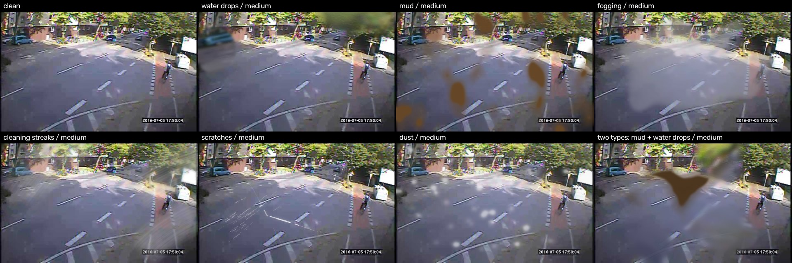
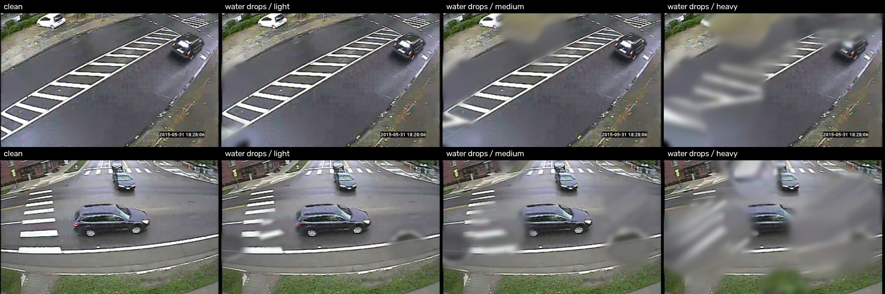
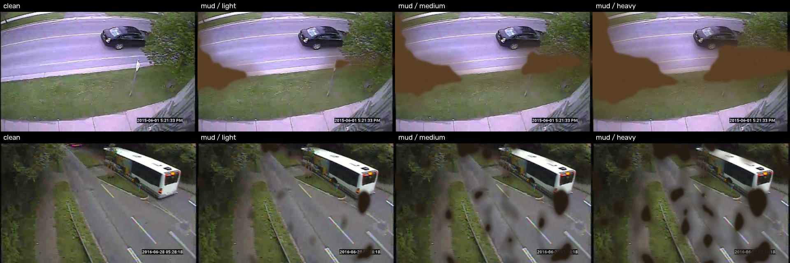
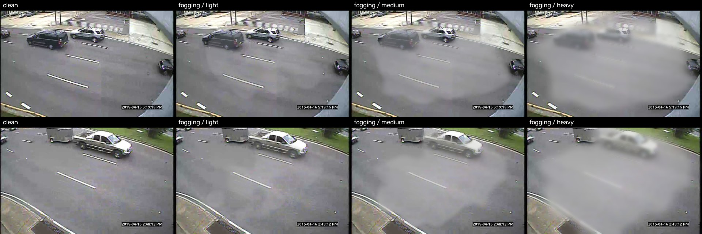
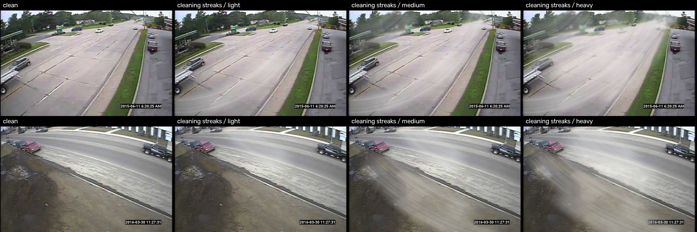
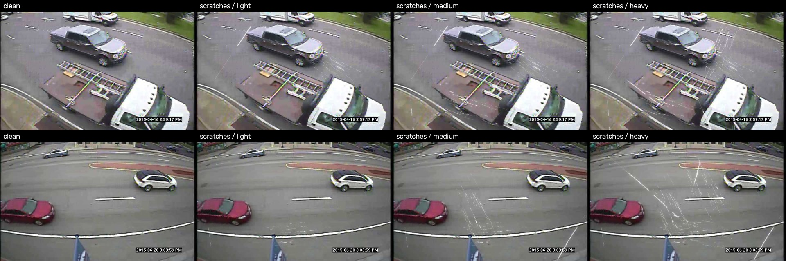
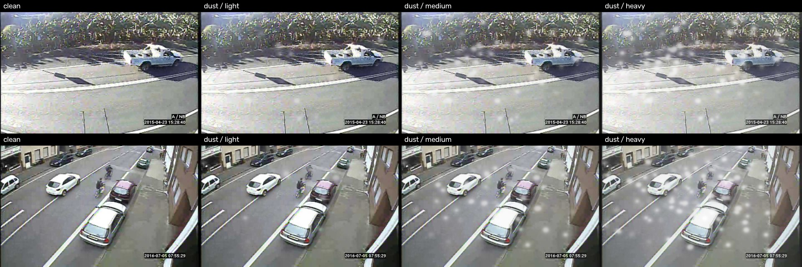

# Synthetic contamination generators

**Status:** all six approved by the user (Session 29, 2026-11-09 – 11-12). The dataset has
**not** been regenerated with them yet: the dataset builder is updated to 6 classes first.

One generator per contamination type of the capture protocol
([`data_collection/datacollection_surveilance_en.md`](data_collection/datacollection_surveilance_en.md)).
Each was shown on sample sheets of randomly chosen photos at light, medium and heavy, changed
until the user approved it, and only then saved.


*One photo: clean, each type at medium, and a two-type example (mud, then water drops).*

---

## 1. Common rules

- **One entry point.** `render_effect(name, image, seed, severity)` in `src/soiling/effects.py`
  returns `(distorted image, mask)`. Names: `water`, `dirt` (mud; the class keeps its old code
  name until the builder is updated), `fogging`, `cleaning_streaks`, `scratch`, `dust`.
  Severities: `low`, `medium`, `high` (light, medium, heavy). The dataset builder
  (`dataset_builder.apply_visible_effect_with_seed`) and the visible-change labels
  (`visible_labels.render_chain`) both call it.
- **Severity is the amount of contamination**, not a fade toward the clean image: more
  droplets, larger stains, more wipe strokes, more sanding, more dust. The earlier fade (30% /
  60% / 100% of one pattern) made light and medium hard to tell apart.
- **Lighter levels are contained in heavier ones.** With the same seed, the droplets, stains,
  strokes, scratches and specks of a light render are also in the medium and heavy renders, as
  more spray strokes, more sanding or more dust would add to what is already on the pane.
- **Reproducible.** The same seed gives the same pixels (needed by the visible-change labels,
  which re-render an image without each effect).
- **Rendered at 1440 px.** Water drops, mud, fogging, cleaning streaks and dust are drawn on the
  photo enlarged to 1440 px wide, and only their change is carried back to the original size,
  so pixels outside the contamination stay exactly as they were. The vendored blur sizes are
  fixed in pixels and were made for larger images than our 720 × 480 photos; at native size the
  same code gives much softer, smeared effects.
- **Visibility check (unchanged).** An effect counts only if at least 20 pixels inside its mask
  change by more than 10 gray levels; otherwise it is re-drawn with a new seed, up to 10 times,
  and left unlabeled if it never shows (e.g. on very dark night photos).

---

## 2. What comes from the paper and what is ours

The paper is Zhang et al., "Procedural generation of lens soiling data via physics-based
simulation", *The Visual Computer* 41, 2025; its code is
[`physical_lens_soiling`](https://github.com/JannLi/physical_lens_soiling), vendored in
`third_party/` (unchanged except an import guard). The paper shows each effect at one strength
only, so **every light / medium / heavy level below is our design**.

| Type | From the paper / its code | Our design |
|---|---|---|
| Water drops | Droplet refraction code, unchanged (Fig. 1 g) | Severity (droplet count, size, strength); rendering at 1440 px |
| Mud | Mud function `add_mudByTxture` and stain shapes, unchanged (Fig. 1 b, c) | Severity (stains shrink); our names for the shapes; rendering at 1440 px |
| Fogging | Mist shapes (`r_fog`, `thick_fog` textures); the paper's statement that mist is drawn like water stains (Fig. 1 f) | Smoothing into one veil, the blur-and-scattered-light rendering, severity |
| Cleaning streaks | — | Everything (the SIDL paper's finding that fingerprint smears blur and defocus supports the rendering) |
| Scratches | — | Sandpaper patches, haze, severity; the line drawer is this project's earlier scratch generator; sandpaper comes from the protocol |
| Dust | Look and description (Fig. 1 e: like mud but lighter and more transparent); speck shapes (`many_dust_drop` texture); mud drawing steps | The amounts of "lighter" and "more transparent", layers, the veil, severity |

---

## 3. The six generators

### 3.1 Water drops — `add_water_droplets`

Water droplets on the pane act as small lenses: each bends a patch of the scene behind it, and
the patch is blurred because the pane is close to the lens. Only the paper's droplet effect
(Fig. 1 g) is used; the earlier "thick" and "thin" water blotches are no longer used for this
class.

**How it is drawn.** For each droplet the vendored `generate_distort_enlarege` (round
magnification) or `droplet_distort_onedirection` (one-sided stretch) warps a polygon-shaped
region with a piecewise-affine transform and blurs it into the image; the mode (all round, all
one-sided, or alternating) is picked at random per image, as in the paper's `add_distort`.

| Severity | Droplets | Droplet scale (paper's unit) | Strength |
|---|---|---|---|
| light | 2–3 | 0.30–0.45 | 90% |
| medium | 4–5 | 0.40–0.60 | 95% |
| heavy | 6–9 | 0.40–0.83 (the paper's range) | 100% |



### 3.2 Mud — `add_mud_stains`

Opaque brown-to-black splashes (Fig. 1 b, c), drawn by the vendored `add_mudByTxture`
unchanged: a stain shape is thresholded into an opaque core with soft edges, the scene behind
it is blurred and covered with a random dark mud colour.

**Stain shapes** — three of the paper's textures, with our names (the fog-like textures are no
longer used for mud, so it cannot look like fogging):

| Our name | Paper's texture | Stain |
|---|---|---|
| `scattered_spots` | `f_water_mud` | many separate, medium-sized spots |
| `large_splashes` | `big_rain_drop` | one or a few large, irregular splashes |
| `single_stain` | `little_rain_drop` | one large central stain with a grey fringe |

**Severity.** Heavy is the paper's full stain. For medium and light the whole texture is lowered
until the opaque area is 50% or 20% of heavy's, so every stain shrinks and the smallest
disappear — less mud on the pane.



### 3.3 Fogging — `add_fog`

Condensation on the pane: a milky veil in which the scene loses sharpness and contrast. The
paper calls it water mist and draws it like its water stains with a whiter colour; the
vendored code has no mist function. A first version that way gave white cotton-like clumps,
which the user found unnatural, so the rendering is ours:

1. a mist shape from the vendored `r_fog` (`patchy_mist`) or `thick_fog` (`dense_mist`)
   texture, smoothed heavily (Gaussian, 4% of the width) into one continuous veil;
2. inside the veil the scene is blurred and mixed with its own light spread out (Gaussian, 8% of
   the width) and lifted 45% toward white, because condensation scatters the scene's light —
   so fog looks darker at night and brighter by day, as on a real pane.

| Severity | Veil area kept | Density | Veil starts at texture value | Blur σ (px at 1440) |
|---|---|---|---|---|
| light | 40% | 45% | 0.20 | 6 |
| medium | 70% | 75% | 0.12 | 9 |
| heavy | 100% | 100% | 0.05 | 12 |

The user asked for the three levels to differ clearly, so area, density and blur all grow
together. A smaller veil shrinks back from its edges, as fog clears.



### 3.4 Cleaning streaks — `add_cleaning_streaks`

Residue of soap or grease left by a badly wiped pane. Neither the paper nor its code has this
type, so the generator is our own, built from how streaks form:

1. **Wipe strokes are curved bands** — a cloth swings around the wrist or elbow, a pivot
   0.6–1.4 image widths outside the image; each stroke is 14–28% of the width wide and is
   anchored on a point inside the image, so it always crosses it.
2. **Residue lines run along the wipe** — the cloth drags the film into fine lines; the film
   thins out and comes back along a stroke.
3. **The film scatters light** — under it the scene is blurred (σ 8 px at 1440) and turns milky
   (half of it lifted 70% toward white); the SIDL paper reports the same overall blur for
   fingerprint smears.

| Severity | Wipe strokes | Film density |
|---|---|---|
| light | 1 | 1.4 |
| medium | 3 | 1.6 |
| heavy | 6 | 1.8 |

(Density multiplies the residue pattern; the result is capped at 95% opacity.) The intensity of
every level was raised once at the user's request before approval.



### 3.5 Scratches — `add_sanding_scratches`

The protocol scratches the pane with sandpaper. One sandpaper stroke leaves a **sanding patch**:
15–30 short scratches (3–10% of the image diagonal) running roughly in one direction, spread
over 12–25% of the diagonal. A few **long single scratches** (20–50% of the diagonal) are added.
Each line is drawn with this project's earlier scratch generator (bright, light-catching lines
of varying width with gaps along their length), and a faint haze (at most 35%) surrounds the scratches
because dense fine scratches scatter light. The paper has no scratch effect.

| Severity | Sanding patches | Long scratches |
|---|---|---|
| light | 1 | 1 |
| medium | 2 | 2 |
| heavy | 4 | 4 |

Sanding only adds damage, so light's scratches are also in medium and heavy. Like real
scratches they show as bright lines against dark areas and nearly vanish on bright scenes, and
they cover a much smaller share of the image than the other types.



### 3.6 Dust — `add_dust`

Fine dust or flour on the pane (Fig. 1 e, "dust in lens"): soft, light, slightly see-through
specks. The paper draws dust like mud stains but lighter, because the dust receives more
ambient light, and more transparent, capped at 255. The vendored code for this effect
(`add_lensdust.py`) was never copied into this project, so these steps are written from the
paper's description, with the mud function's mask and blur steps and the paper's
`many_dust_drop` texture for the speck shapes.

| Severity | Layers of specks | Speck opacity | Veil over the whole pane |
|---|---|---|---|
| light | 1 | 55% | 2% |
| medium | 3 | 80% | 10% |
| heavy | 6 | 95% | 22% |

Specks are lifted 70% toward white. Dust settles in layers, so each level adds layers on top of
the ones before; the finest dust also veils the whole pane a little. The levels were spread
further apart once at the user's request.



---

## 4. Measured strength

Share of the image that each generator visibly changes (more than 10 gray levels in any
color channel), on 20 randomly chosen photos (night scenes included, so the lowest values are
mostly dark photos). Mean, with the range over the 20 photos in brackets.
Data: [`results/generator_stats.json`](../results/generator_stats.json).

| Type | Light | Medium | Heavy |
|---|---|---|---|
| Water drops | 5.8% (1.5–11.4%) | 19.1% (10.1–27.2%) | 39.1% (23.6–50.0%) |
| Mud | 9.6% (1.2–20.3%) | 23.4% (3.6–37.8%) | 48.3% (27.8–64.2%) |
| Fogging | 9.0% (1.2–14.3%) | 32.3% (14.7–38.7%) | 52.6% (27.4–59.5%) |
| Cleaning streaks | 12.9% (1.7–22.3%) | 31.3% (8.7–47.0%) | 53.1% (30.6–68.7%) |
| Scratches | 0.6% (0.3–1.3%) | 1.1% (0.6–2.0%) | 2.4% (0.9–4.5%) |
| Dust | 1.7% (0.4–3.1%) | 26.2% (7.0–38.9%) | 77.8% (27.5–95.5%) |

- Every type changes more at each level, on average and in its lowest and highest values.
- All 360 renders (20 photos × 6 types × 3 levels) passed the visibility check on the first
  try, so no level of any type vanishes on these photos.
- **Light is the faint case** the project aims to detect: 1–13% of the image.
- **Scratches** cover a far smaller share than the other types by nature (thin lines), so their
  tile and pixel cutoffs will need their own calibration, as the scratch class already has.
- **Heavy dust** changes most of the image mainly through its veil, not the specks.

---

## 5. Reproduce

```bash
python scripts/render_generator_samples.py --source data/raw/mio_tcd/images \
    --out-dir docs/images/generators --stats-json results/generator_stats.json
python -m pytest -q tests/test_effects_dirt_water.py
```

The figures use photos chosen reproducibly among daylight scenes (seed 0); the measurements
use randomly chosen photos, night scenes included (seed 1).
